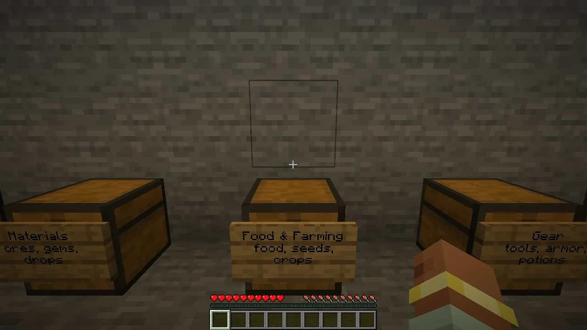
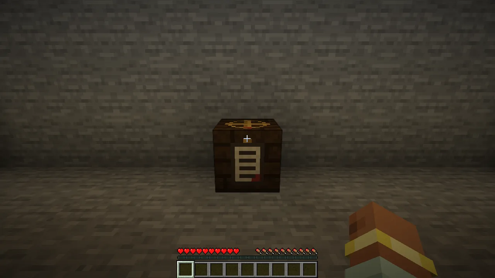
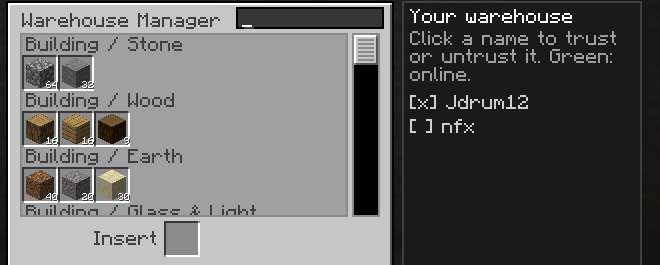
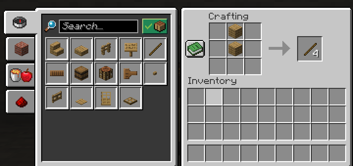
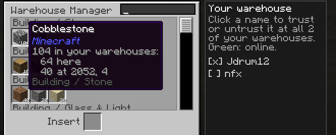
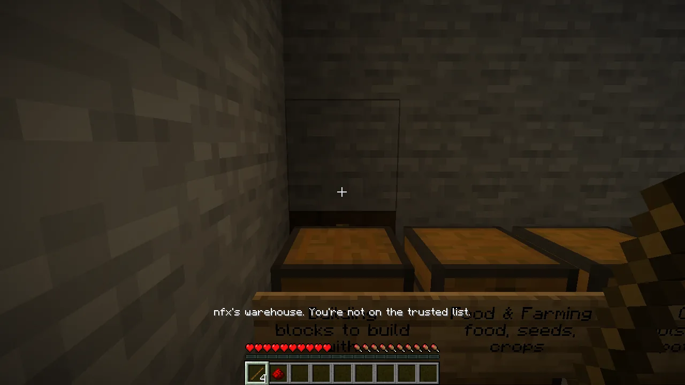
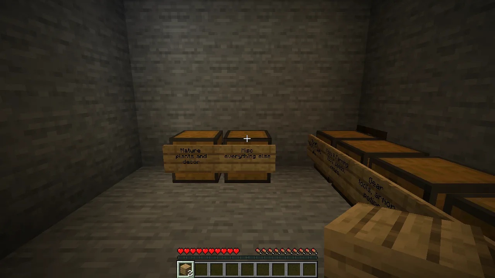

Place a **Warehouse Manager** inside a building full of chests and it becomes a warehouse. It
finds every chest and barrel under that roof, decides which holds what, moves everything until
each holds one kind of thing, and **writes a sign on each**. Open the manager to see and search
everything at once, take what you need, or drop things in to be put away. **Crafting tables in the
building craft straight from the chests.** All your warehouses, however far apart, work as one.

## Getting started

1. **Craft it:**

   | | | |
   |---|---|---|
   | paper | book | paper |
   | iron ingot | chest | iron ingot |
   | paper | redstone | paper |

2. **Place it inside a building** with chests, trapped chests or barrels. It maps the building
   (every floor, through doors, stairs and ladders, but not out under the open sky), then sorts
   and labels. A double chest gets two signs: the group's name, and what's typically in it.
3. **It's yours.** Whoever places the manager owns the warehouse.

**Heads up: existing contents move.** That's the point, but warn anyone else using the building.

## The manager's screen

Right-click the manager to see **everything the warehouse holds** (and your other warehouses),
each kind in one cell with its total, under headings like *Building / Stone* and *Food & Farming*.

- **Search:** type in the box at the top. `iron` finds Iron Ingot and Iron Pickaxe; a group's name
  finds the whole group; `@create` shows one mod's items.
- **Taking:** like a chest slot. Left-click lifts a stack, right-click half, shift-click sends a
  stack to your inventory. Items come from the nearest chest first.
- **Putting away:** put a stack in the **Insert** slot (or shift-click it from your inventory) and
  it's sent to the right chest within a tick or two. Anything with no room stays in the slot.
- Hover over a cell for the item and its total.

## Crafting from the warehouse

Open a **crafting table inside the building** and the recipe book (or **EMI**) counts the chests as
if they were in your pockets:

- Recipes you could make from the warehouse **light up as craftable**. Click one and the
  ingredients come out of the chests into the grid.
- **Parts count too.** If a recipe needs something that isn't in any chest but could be crafted
  from what is, it still lights up, however many steps down. Click it and the parts are made first:
  "Made 9 × Steel Ingot, 1 × Upper Receiver, 1 × Lower Receiver, 1 × Barrel, 1 × Stock for Rifle."
- **Your backpacks count** before the chests do.
- Click the same recipe again to pile on one more craft; shift-click the result to make them all.
- If something's missing, chat says exactly what: "Can't fill Engine from here: short of 1 × Boiler."
- It never breaks down what you're making to make its own ingredients.

## All your warehouses are one

Every manager you own joins **one network**, in any dimension, with nothing to link:

- **The index and the crafting tables count all of them.** A cell's tooltip says where the items
  are ("104 in your warehouses: 64 here, 40 at 2052, 4").
- **Deposits spread out:** anything you put in goes to whichever of your warehouses has least of it,
  so losing one building loses a share of everything, not all of something. Items may end up in
  another village's chests; the tooltip says where.
- **Far warehouses load when you walk into one of yours** (or a player you trust does), and stay
  loaded for a minute after you leave. Their stock arrives within about a second, usually before
  you reach a table.
- **One trusted list** covers all your warehouses.

## Who can use it

Open the manager and a panel beside the grid lists every player the world has seen (online ones in
green). **Click a name to trust or untrust them.**

| | You and the players you trust | Everyone else |
|---|---|---|
| Crafting from the chests | yes | no: just their own inventory |
| Opening the manager and its chests and barrels | yes | refused |
| Breaking a chest or the manager | yes | refused |
| Changing who's trusted | the owner only | no |

- **Explosions can't touch it:** the manager and its chests survive creepers and rockets.
- **One manager per building.** Placing a second one is refused, saying whose manager runs it and
  where.
- **A manager from before ownership existed** stays open to everyone until somebody sneaks and
  right-clicks it, which makes them the owner.
- A hopper under a chest can still drain it. That's the one way in for strangers.

## An empty room

A building with no chests gets them from you: **drop chests or barrels into the manager** and it
stands them along the walls, facing into the room, as the groups need them. Two chest items become
a double chest beside a group that's nearly full.

## If something seems wrong

- **Right-click the manager** for its status: "mapping the building", "N containers managed,
  everything in its place", "sorting", or "N stacks waiting, no room in Stone".
- **A chest isn't sorted:** the manager can't reach it. There's a wall in between, it's under open
  sky, or the building is too big. Put a roof over it or move the manager nearer.
- **Things stay in the Insert slot:** the warehouse is full for that group. Stand another chest and
  it sorts itself out.
- **"…'s warehouse. You're not on the trusted list.":** ask the owner to tick your name.
